<div align="center">

<!-- 1) Animated hacker banner (original pixel art untouched; screens scroll ASCII code, hands type) -->


```text
    _____  ____  _______ __  __
   /   \ \/ / / / / ___// / / /
  / /| |\  / / / /\__ \/ /_/ / 
 / ___ |/ / /_/ /___/ / __  /  
/_/  |_/_/\____//____/_/ /_/   
```

# Welcome to Ayush's Digital Universe

I build practical products across AI/ML, intelligent dashboards, security-focused systems, and modern web apps. I enjoy taking ambitious ideas from concept to working software that people can actually use.

<br clear="right"/>

---

## Featured Projects

<div align="center">

| Project | Description | Tech |
|---|---|---|
| **MITRA** | Suicide prevention app. AI-assisted platform for mental stability and interactive support. | `JavaScript` |
| **DDOS-AI-Detector** | Real-time ML DDoS detection dashboard with live inference engine and alert system. | `Python` |
| **QueryViz** | Conversational BI dashboard with FastAPI + Gemini 2.5 Flash text-to-SQL and Next.js 14. | `Python` |
| **Red vs Blue RL Sim** | PPO attacker vs defender on 5-node network using Stable-Baselines3 and Gymnasium. | `Python` |
| **UPI Fraud Checker** | Isolation Forest + Logistic Regression fraud detection with a Flask dashboard. | `HTML` `Python` |
| **BOMB-AI-DETECTOR** | TypeScript-powered explosive detection AI system with layered-risk architecture. | `TypeScript` |

</div>

---

## Technology Stack

| Category | Technologies |
|---|---|
| Languages | Python, JavaScript, TypeScript, SQL, C++ |
| AI / ML | scikit-learn, Stable-Baselines3, Gymnasium, Gemini API |
| Web | Next.js, React, Flask, FastAPI, Firebase |
| Tools | Arduino, Linux, Git, MySQL |

---

## GitHub Snapshot

<div align="center">

| Metric | Value |
|---|---:|
| Public repositories | `20+` |
| Contributions | `59` |
| Followers | `16` |
| Top languages | `Python`, `TypeScript`, `JavaScript`, `HTML` |

</div>

---

## What I'm Working On

- Building AI-assisted products with real-world utility
- Exploring reinforcement learning, cyber security, and intelligent automation
- Shipping full-stack apps with Python, TypeScript, Flask, FastAPI, and Next.js
- Contributing to practical open source and collaborative projects

---

## Connect With Me

LinkedIn: [ayush-verma-010a69367](https://www.linkedin.com/in/ayush-verma-010a69367)

Email: [averma2988225@gmail.com](mailto:averma2988225@gmail.com)

`CREEPY ELECTRON OS v2026` · Made with love in India

---

## Dev Quote

<div align="center">

> "Code is like humor. When you have to explain it, it's bad."

</div>

---

**From [averma2988225-droid](https://github.com/averma2988225-droid)**
